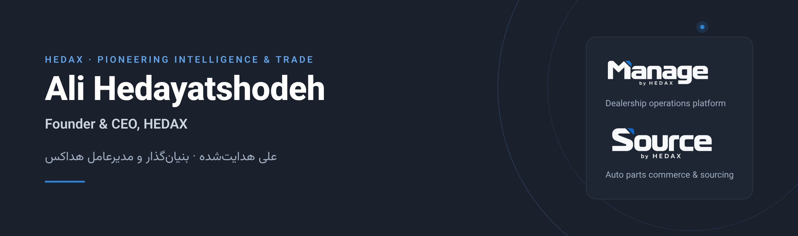
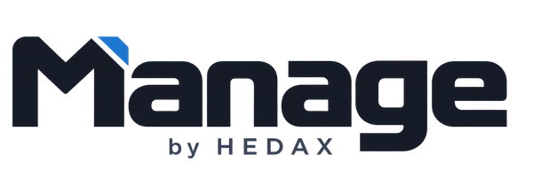
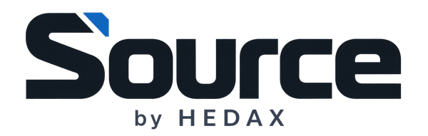
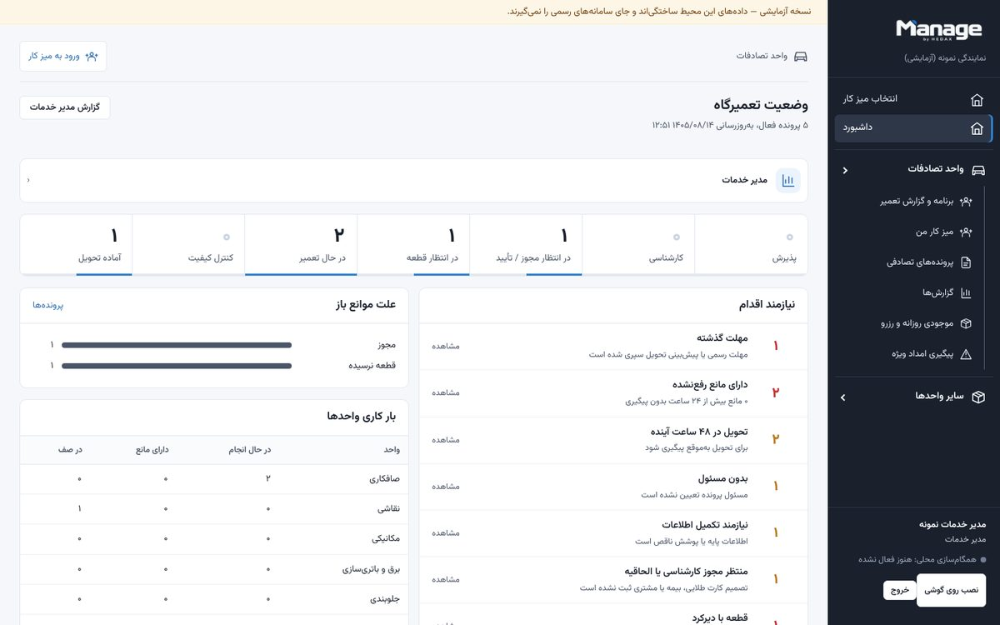
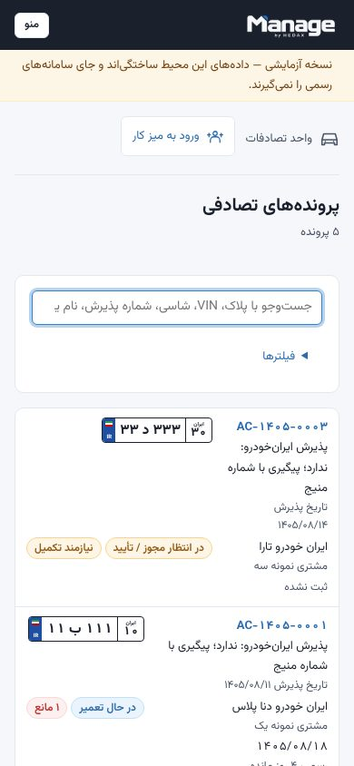

  

I build practical software for the automotive and trade businesses I have worked in for more than twenty years: trade, sourcing, service management and executive roles across automotive, oil & gas and general trading. **HEDAX** is the company that turns that experience into digital products.

## Products

<table>
  <tr>
    <td width="50%" valign="top">
        
      <b>Dealership operations platform</b> 
      From intake to delivery, in full view. Manage tracks every vehicle in a dealership's workshop: assessment and insurance approvals, parts, repair stations, blockers, quality control and handover, with role-based workspaces for each team.  
      Persian (RTL) · role-based access · two-factor sign-in · full audit trail · installable mobile app  
      <b>Status:</b> first module (accident repair) in testing at an Iran Khodro dealership. Built for multi-brand, multi-dealership use. 
      <a href="https://managebyhedax.ir">managebyhedax.ir</a> (staff sign-in)
    </td>
    <td width="50%" valign="top">
        
      <b>Auto parts commerce and custom sourcing</b> 
      An online store for available parts connected to a custom sourcing service: requests for any brand, versioned quotations, staff operations and fulfillment in one workflow.  
      Persian and English · catalog and search · quotations in IRR and AED · staff MFA · audit history  
      <b>Status:</b> pre-launch; the public site is online. 
      <a href="https://sourcebyhedax.ir/fa">sourcebyhedax.ir</a>
    </td>
  </tr>
</table>

  
  &nbsp;
  
   
  Manage by HEDAX: service manager dashboard and the case list on a phone. Screenshots use synthetic demo data.

## How the products are built

| | |
| --- | --- |
| Web and apps | Next.js, React, TypeScript; Persian-first right-to-left interfaces |
| Services | NestJS, PostgreSQL, Redis, background workers |
| Operations | Docker, Caddy, ArvanCloud; automated tests and CI on every change |
| Security | Role-based access enforced on the server, two-factor sign-in, immutable audit log |

## HEDAX

**Pioneering Intelligence & Trade.** Smart trade and supply-chain solutions, based in Dubai.
The [HEDAX brand guide](https://github.com/ali-hedax/brand-guide-hedax) sets the visual and verbal identity shared by every product.

### به فارسی

علی هدایت‌شده، بنیان‌گذار و مدیرعامل هداکس. با بیش از بیست سال تجربه در بازرگانی، تأمین، مدیریت خدمات و مدیریت اجرایی، نرم‌افزارهایی می‌سازم که کار واقعی کسب‌وکارهای خودرویی و بازرگانی را ساده‌تر می‌کنند.

- **Manage by HEDAX** ([managebyhedax.ir](https://managebyhedax.ir)): سامانهٔ یکپارچهٔ مدیریت عملیات نمایندگی‌های خودرو. از پذیرش تا تحویل، با دید روشن.
- **Source by HEDAX** ([sourcebyhedax.ir](https://sourcebyhedax.ir/fa)): فروش قطعات خودرو و تأمین سفارشی، فارسی و انگلیسی.

## Contact

hedayatshodehali@gmail.com
