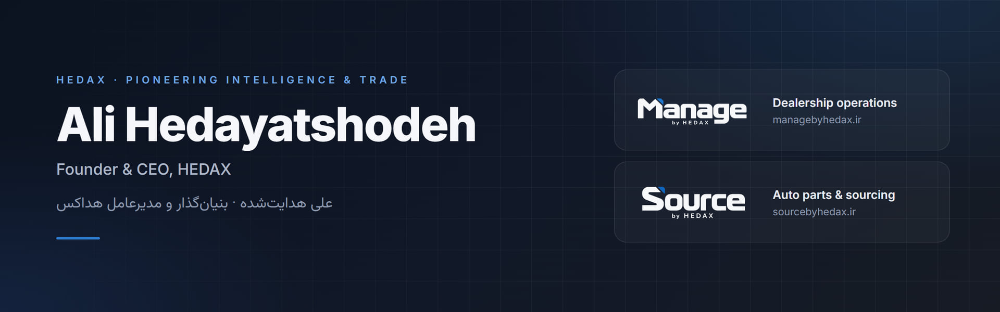
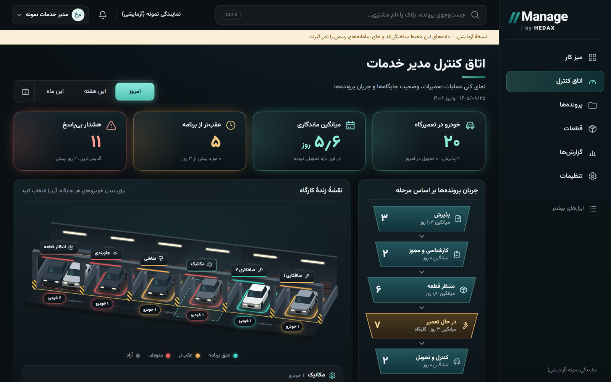
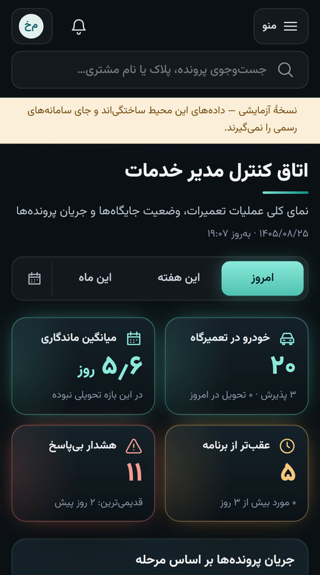
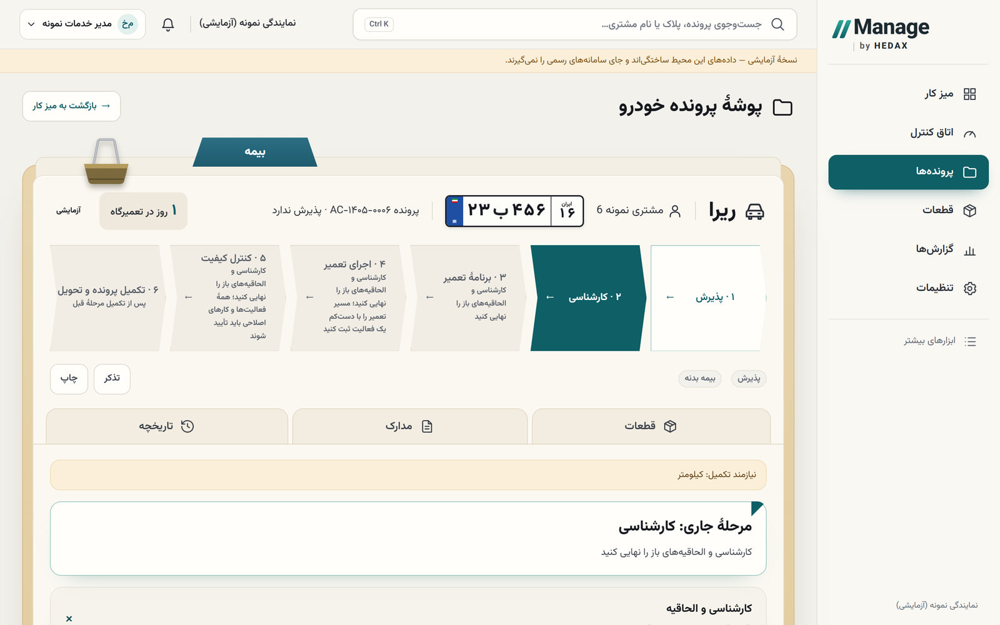
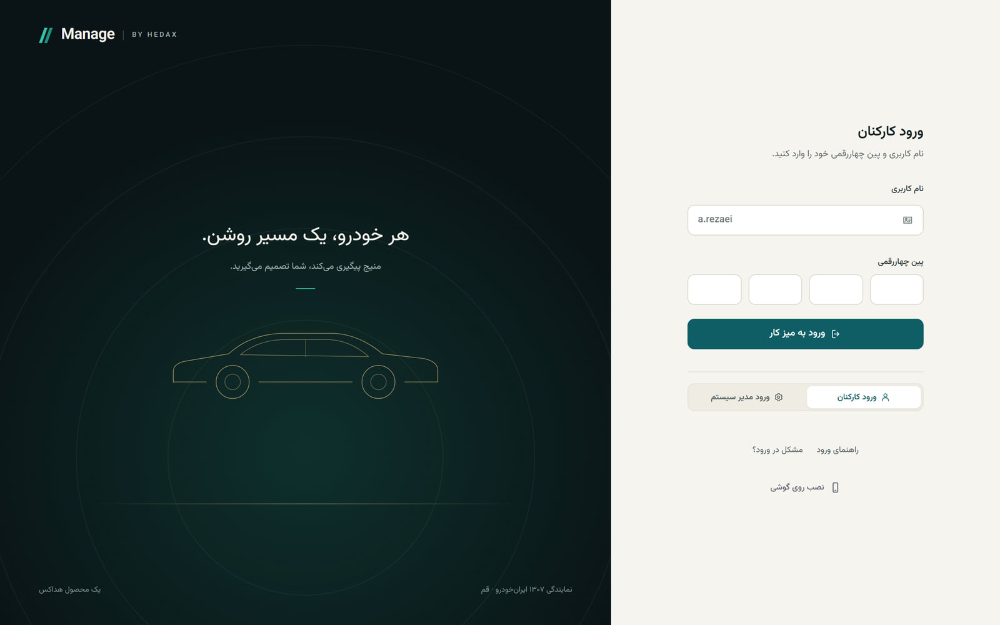
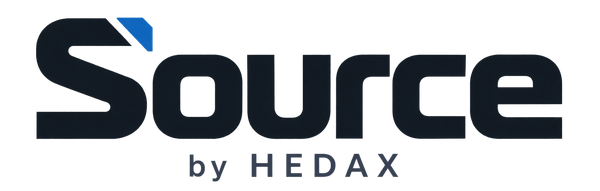
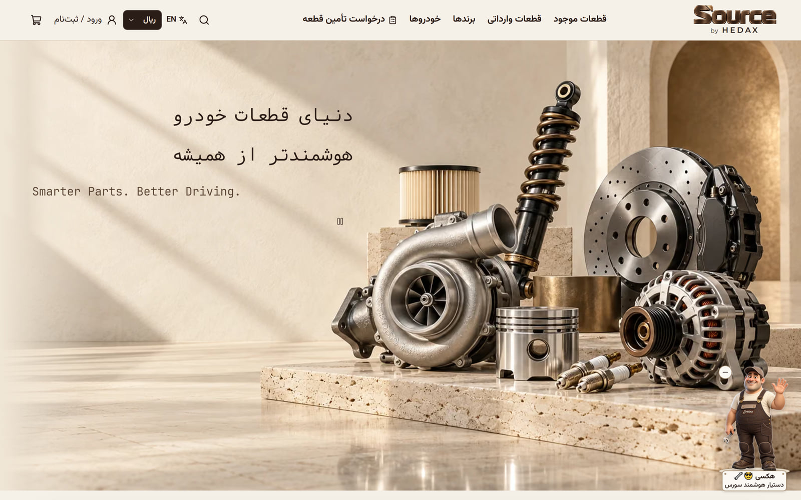
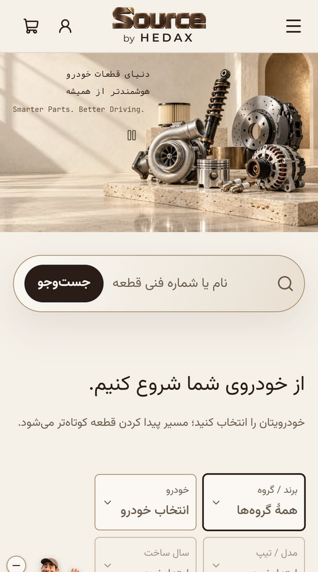
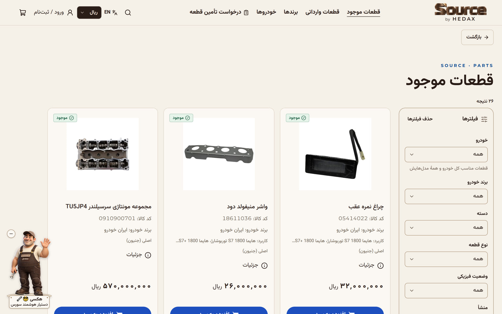

  

**HEDAX** builds practical software for the automotive and trade businesses it comes from. I founded it after more than twenty years in trade, sourcing, service management and executive roles across automotive, oil & gas and general trading. Each product starts from a real operational problem and is used by the people who have it.

 

  <picture>
    <source media="(prefers-color-scheme: dark)" srcset="assets/manage-logo-dark.png">
    
  </picture>

**Dealership operations platform: every vehicle, one clear path.**
Manage tracks each car in a dealership workshop from intake to delivery. Every role works in its own workspace, and the service manager sees where work is stuck.

  
  &nbsp;
  

  
  &nbsp;
  
   
  Control room, vehicle case folder and staff sign-in. Inside screens use the synthetic demo dealership; no real customer data.

- **Guided case path:** intake, assessment, repair plan, repair, quality control, completion and delivery.
- **Control room** for the service manager: vehicles in the workshop, average stay, overdue work, open alerts, a live workshop map and the case flow by stage.
- **Parts and stock:** one parts list per vehicle, reservations against the daily stock report, market purchases and returns.
- **Role-based workspaces:** accident experts, parts, station technicians, service manager and system administration.
- Persian, right-to-left · PIN sign-in for staff, authenticator app for administrators · installable on phones.

**Status:** the accident-repair module is in daily use at an Iran Khodro dealership.
[managebyhedax.ir](https://managebyhedax.ir) (staff sign-in) · [repository](https://github.com/ali-hedax/manage-dealership-platform)

 

  <picture>
    <source media="(prefers-color-scheme: dark)" srcset="assets/source-logo-dark.png">
    
  </picture>

**Auto parts store and custom sourcing.**
An online store for parts in stock, joined to a sourcing service for anything that is not: customers ask for any part for any brand and follow the request through quotation and fulfilment.

  
  &nbsp;
  

  
   
  Live storefront at sourcebyhedax.ir: home page, phone layout and parts catalog.

- **Catalog and search:** search by part name or part number; filter by vehicle, brand, category, part type, condition and origin.
- **Vehicle finder:** start from the car and see compatible parts.
- **Custom sourcing requests** with versioned quotations; prices in IRR, with AED reference pricing.
- **Hexi**, the store assistant, answers from the live catalog.
- Persian and English · staff two-factor sign-in · audit history.

**Status:** pre-launch. The public site is online; customer SMS sign-in and online payment are not connected yet.
[sourcebyhedax.ir](https://sourcebyhedax.ir/fa) · [repository](https://github.com/ali-hedax/source-auto-parts-platform)

 

## How the products are built

| | |
| --- | --- |
| Web and apps | Next.js, React, TypeScript; Persian-first right-to-left interfaces |
| Services | NestJS, PostgreSQL, Redis, background workers |
| Assistant | Catalog-grounded AI assistant with spend and request limits |
| Operations | Docker, Caddy, ArvanCloud; automated tests and CI on every change |
| Security | Role-based access enforced on the server, two-factor sign-in, audit log |

## Repositories

| Repository | Contents |
| --- | --- |
| [manage-dealership-platform](https://github.com/ali-hedax/manage-dealership-platform) | Manage by HEDAX: web app, API and documentation |
| [source-auto-parts-platform](https://github.com/ali-hedax/source-auto-parts-platform) | Source by HEDAX: storefront, administration, API and workers |
| [brand-guide-hedax](https://github.com/ali-hedax/brand-guide-hedax) | HEDAX visual and verbal identity |

## HEDAX

**Pioneering Intelligence & Trade.** Smart trade and supply-chain solutions, based in Dubai.

### به فارسی

علی هدایت‌شده، بنیان‌گذار و مدیرعامل هداکس. با بیش از بیست سال تجربه در بازرگانی، تأمین، مدیریت خدمات و مدیریت اجرایی، نرم‌افزارهایی می‌سازم که کار واقعی کسب‌وکارهای خودرویی و بازرگانی را ساده‌تر می‌کنند.

- **Manage by HEDAX** ([managebyhedax.ir](https://managebyhedax.ir)): سامانهٔ یکپارچهٔ مدیریت عملیات نمایندگی‌های خودرو. هر خودرو، یک مسیر روشن؛ از پذیرش تا تحویل.
- **Source by HEDAX** ([sourcebyhedax.ir](https://sourcebyhedax.ir/fa)): فروشگاه قطعات خودرو و تأمین سفارشی، فارسی و انگلیسی.

## Contact

hedayatshodehali@gmail.com
